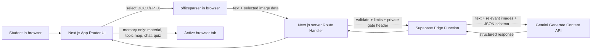

# AI Lecture Tutor — Technical Spec

This blueprint implements `prd.md` and carries forward the product boundaries in `scope.md`. The working title remains temporary.

## How This Works, In Plain Language

Next.js gives us the React app and a small server-side route. The student’s browser handles the parts that need a person or a file: the welcome and demo forms, document upload, interactive lesson, quiz, and animations. The browser reads the Word or PowerPoint file with `officeparser`, then sends the extracted lesson text and useful images to our Next.js server route.

That route is a private doorway. It checks the request and sends it to our Supabase Edge Function with a secret header that is kept on the server. The Edge Function checks that header, validates the data, and calls the Gemini API. Gemini’s key stays in Supabase secrets. The answer travels back through the same route to the browser. The browser keeps the material, topic map, conversation, and quiz in memory for this demo; closing or refreshing the tab clears them.

TypeScript helps us catch mismatched data shapes while writing the app. Zod checks real incoming data while the app is running, because a file, network request, or AI response can still be malformed even when our code has TypeScript types. We define small Zod schemas at important boundaries and derive their TypeScript types from those schemas. Gemini structured output asks the model to return a matching JSON shape; Zod checks that result again. These checks do not establish that an explanation or grade is factually correct.

The extra Next.js server doorway is here because the prototype has no real accounts. The Supabase function will reject calls that do not include the private server-to-server gate secret. The Next.js route will validate each action and enforce small demo limits before forwarding it. This keeps a direct, unrestricted path to the AI provider out of the browser. The limits are suitable for a local recorded demo, not a public production service.

## The Core Journey Through the System

Implements `prd.md > The Core Journey`.



1. The student uses the lightweight Sign Up or Log In form. Required fields are checked in the browser; they do not create an account. The student goes straight to upload. (`prd.md > Welcome and lightweight entry`)
2. The student selects one `.docx` or `.pptx`. The browser checks the extension and file size, displays the file name, and `officeparser` extracts text and embedded images. The UI shows the reading, topic-identification, and preparation states. (`prd.md > Upload, analysis, and topic selection`)
3. The browser sends extracted text and image attachments to `POST /api/tutor`. The Next.js Route Handler checks the request against Zod, applies request/session limits, and forwards it to the Supabase Function with a server-only shared gate secret. (`prd.md > Upload, analysis, and topic selection`; `prd.md > Product Decisions`)
4. The Edge Function validates the private header and request again, then sends text, images, and a JSON Schema to the Gemini Generate Content API. A strict output schema asks the model for a small topic map: topic titles and summaries, relevant text excerpts, and references/captions for useful visual items. The Edge Function validates the returned object with Zod before responding. The configurable Gemini Flash model supports text and image input and structured JSON output. [Gemini model availability](https://ai.google.dev/gemini-api/docs/models), [image understanding](https://ai.google.dev/gemini-api/docs/image-understanding), [structured output](https://ai.google.dev/gemini-api/docs/structured-output)
5. The browser stores the topic map and images in React state and shows the ready state. The student chooses one topic. For each teaching turn, the browser sends that topic’s excerpts and only its relevant visual references, plus a bounded set of recent turns and the student’s reply. The tutor response contains a short explanation/question, an understanding judgment, and a next-step hint. The UI displays it and appends the turn. (`prd.md > AI-led tutoring session`)
6. The student chooses **I’m Ready for the Quiz**, then a type and requested size. The browser sends the selected topic context and quiz settings. The model returns questions, choices or theory prompts, and internal grading guidance in a structured response. The UI shows only the question-facing fields. The student’s submitted answers are sent for grading with the question criteria and relevant source context. (`prd.md > Quiz and results`)
7. The UI displays total answered, passed, failed, percentage score, encouragement, and revision areas, then retains the result only for the active tab. (`prd.md > Quiz and results`)

## Stack

- **Next.js 16 App Router + React + TypeScript** — the learner-selected React framework. App Router folders define routes; pages and layouts are Server Components by default, while components that need browser APIs, state, or event handlers use `'use client'`. The interactive tutoring experience is a Client Component tree; `app/api/tutor/route.ts` is a server Route Handler. [App Router](https://nextjs.org/docs/app), [Server and Client Components](https://nextjs.org/docs/app/getting-started/server-and-client-components), [Route Handlers](https://nextjs.org/docs/app/getting-started/route-handlers)
- **Tailwind CSS** — responsive styling through utility classes, consistent with the approved palette. [Next.js setup](https://tailwindcss.com/docs/installation/framework-guides/nextjs)
- **Motion for React** (formerly Framer Motion; npm package `motion`, import from `motion/react`) — page and interaction motion in Client Components. GSAP is deferred. [Installation and Next.js guidance](https://motion.dev/docs/react-installation)
- **`officeparser@8.1.0`** — browser-side extraction from `.docx` and `.pptx`, including attachments when configured. The current npm package documentation lists Node.js >=22.13 and documents a browser ESM bundle for Next.js and direct `File`/`ArrayBuffer` input. [Current npm package and README](https://www.npmjs.com/package/officeparser)
- **Zod** — runtime request/response checks and source for inferred TypeScript types. Keep schemas small and at shared boundaries. [Zod](https://zod.dev/)
- **Supabase Edge Functions** — one Deno/TypeScript function for secure Gemini calls and server-side validation. [Edge Functions](https://supabase.com/docs/guides/functions)
- **Gemini Generate Content API** ? one model, configurable using `GEMINI_MODEL=gemini-3.8-flash`; the function sends only the material context needed for that action. The selected Gemini Flash model supports image inputs and structured JSON output. [Model reference](https://ai.google.dev/gemini-api/docs/models), [Generate Content API](https://ai.google.dev/api/generate-content)

## Where It Runs and How Someone Tries It

- **Local demo:** Run the Next.js app and Supabase Edge Function during development. The exact first-run setup will be completed in `5-build` after checking current package compatibility. The intended app command is `npm run dev`; open `http://localhost:3000`.
- **Runtime:** Use Node.js **22.13 or newer** for Next.js 16 and `officeparser@8.1.0`. Next.js 16 lists Node.js 20.9+ as its minimum, so Node 22.13 meets both requirements. Pin Node 22.13+ in `.nvmrc` (exact patch selected when scaffolding). The Supabase Edge Function runs on Deno. [Next.js 16 requirements](https://nextjs.org/docs/app/guides/upgrading/version-16), [officeparser package requirements](https://www.npmjs.com/package/officeparser)
- **Supabase setup:** A Supabase project and deployed `tutor` Edge Function are needed for live Gemini calls. The function secrets include `GEMINI_API_KEY`, `GEMINI_MODEL=gemini-3.8-flash`, and `TUTOR_GATE_SECRET`. The Next.js server environment includes the Supabase function URL and the matching `TUTOR_GATE_SECRET`. Never use a `NEXT_PUBLIC_` prefix for either secret. Supabase documents server-only function secrets. [Supabase function secrets](https://supabase.com/docs/guides/functions/secrets)
- **Demo entry:** The Sign Up and Log In screens remain prototype-only as required by the PRD. No students need persistent accounts. Deployment is optional; use a local screen recording for the hackathon demo. Submission still requires a short demo video and a public GitHub repository.
- **Secrets:** Use ignored local `.env.local` and Supabase’s function-secret mechanism. Commit only `.env.example` names without values. Keep separate, randomly generated matching gate secrets for local and deployed environments.

## Look and Feel

Implements `prd.md > Look and Feel`. Use a deep navy base and restrained violet for tutor surfaces, with soft gradients/glows, quiet gray borders and text, and spacious rounded panels. Reserve dark green for progress/success and burgundy for warnings or selected emphasis. Use readable, calm typography and concise supportive copy. Tailwind owns layout and static styles; Motion adds brief transitions and feedback where movement clarifies a state change. Respect reduced-motion preferences and keep the conversation easy to read.

## Components

### App Router shell and study flow

`app/layout.tsx` supplies the document shell, fonts, global styles, and page metadata as a Server Component. `app/page.tsx` hosts the interactive flow. A Client Component owns current screen, form fields, selected file, topic map, conversation, quiz, and results because these depend on clicks and browser file APIs. It does not persist credentials or study state.

Implements `prd.md > The Core Journey`, `prd.md > Screens and Layout`, and `prd.md > States and Boundaries`.

### Welcome and demo entry forms

Show the tutor introduction and Sign Up/Log In forms. Validate required fields locally; do not send/store the password or claim to create an account. Successful form completion switches to upload.

Implements `prd.md > Welcome and lightweight entry`.

### Document picker and browser parser

Accept one DOCX/PPTX, show its name and analysis progress, call `officeparser` with attachment extraction, convert its output into bounded text and image records, and provide retry on parse errors. Keep both extracted material and images in browser memory. During `5-build`, test representative lecture documents including formatted slides, charts, diagrams, and embedded images as explicitly requested. Set initial POC caps: one file up to 15 MB, at most 10 relevant extracted images, each normalized to a supported image format and at most 1 MB, and extracted text capped at 80,000 characters. These are practical demo limits to verify against sample files; a cap failure should explain how to reduce the file or try another one.

Implements `prd.md > Upload, analysis, and topic selection` and `prd.md > States and Boundaries`.

### Next.js tutor Route Handler and access gate

`POST /api/tutor` is the browser’s only AI-call route. It accepts the action request, parses it with Zod, checks the active demo session’s request budget and payload bounds, then forwards the validated JSON to the Supabase Function. It adds `x-tutor-gate: <TUTOR_GATE_SECRET>` on the server. The secret exists only in server environment and Supabase Function secrets; never in React props, browser code, `NEXT_PUBLIC_` variables, or logs.

Use a server-issued, HTTP-only demo-session cookie (no user account) to count requests per browser session in a small in-memory limiter; the first accepted request sets the cookie. Allow at most 30 model calls per session and no more than one call per second. Return a friendly `429` message when the budget is reached. Keep this local-demo limiter intentionally simple: in-memory counts reset when the server restarts and are not shared across multiple server instances. Do not present it as production-grade protection.

Implements `prd.md > Product Decisions` and supports `prd.md > Upload, analysis, and topic selection`, `AI-led tutoring session`, and `Quiz and results`.

### Supabase Edge Function: `tutor`

One function accepts a discriminated action (`analyze`, `teach`, `generateQuiz`, or `gradeQuiz`). It rejects a missing/incorrect `x-tutor-gate` secret before any Gemini call, validates payloads with the shared Zod contracts, applies hard payload and output-size limits, calls Gemini with its server-side key, checks for refusals/missing output, parses the structured result, validates again, and returns a typed JSON response. Configure the function so the platform-level JWT check is disabled for this server-to-server call, but enforce the application gate header inside the function handler. Supabase’s function documentation distinguishes gateway JWT checks from handler-level authorization; turning off JWT checks alone would leave an unauthenticated function, so the in-handler shared-secret check is mandatory. [Supabase authorization headers](https://supabase.com/docs/guides/functions/auth-headers), [Edge Function security](https://supabase.com/docs/guides/functions/auth)

The shared gate secret prevents direct use of the Supabase function by callers who do not control the Next.js server environment. As the Next.js app is local-only for this POC, its local server is the only proxy entry point during the demo. If deployment is added later, the public Next.js route also needs a stronger abuse-control plan (for example managed rate limiting and an access credential); the demo-only mock Sign Up/Log In screens are not security controls. This boundary and limitation must stay visible in `README.md`.

Implements `prd.md > Product Decisions`, `prd.md > AI-led tutoring session`, and `prd.md > Quiz and results`.

### Gemini Generate Content adapter

The Edge Function sends requests to the Gemini `:generateContent` endpoint with `model: Deno.env.get("GEMINI_MODEL")`, instructions for supportive, material-grounded tutoring, extracted text, inline image bytes, and `generationConfig.responseJsonSchema`. Use one schema per action rather than a single complicated output union. The function returns only the validated application object, never raw provider internals. Zod supplies the JSON Schema shape and then validates the model response again at runtime. [Generate Content API](https://ai.google.dev/api/generate-content), [structured output](https://ai.google.dev/gemini-api/docs/structured-output)

Implements `prd.md > Upload, analysis, and topic selection`, `prd.md > AI-led tutoring session`, and `prd.md > Quiz and results`.

### Topic picker, tutor conversation, quiz, and results UI

The topic picker starts one lesson. The tutor UI displays conversational turns and lets the AI lead each next step. Its structured response includes a judgment such as `understood`, `needs_reteach`, or `unclear`, plus a short tutor message and the next teaching action. If the student is confused or incorrect, the prompt directs a different simpler explanation and a new check question. The student’s ready action opens quiz setup without forcing a quiz.

Quiz UI lets the student select Objective/Theory and 5/10/15. Objective answers are single-choice; theory answers are typed. Submit the answers together for evaluation; theory grading includes required concepts and accepts equivalent wording. If quality/source context cannot support the requested count, the validated generated quiz may contain fewer questions. The result UI shows the required score and revision feedback.

Implements `prd.md > AI-led tutoring session`, `prd.md > Quiz and results`, and `prd.md > States and Boundaries`.

### Zod contracts and TypeScript types

Keep shared contracts in `shared/contracts.ts`, imported by the Next.js app and Supabase function. TypeScript types disappear at runtime; they help the editor and compiler catch mistakes in code we write. Zod schemas execute at runtime: for example, `AnalyzeRequestSchema.safeParse(await request.json())` checks that an actual HTTP body has the expected fields, types, lengths, and limits. `z.infer<typeof AnalyzeRequestSchema>` derives the TypeScript type from the schema so we don’t maintain two copies of the same shape.

Focused shared shapes:

- `AnalyzeRequest`: action, material text, file label/type, and bounded images `{ id, mimeType, dataUrl }`.
- `TopicMap`: topic IDs/titles/summaries, excerpt IDs and source text, and visual references pointing to image IDs with a short description.
- `TeachRequest` / `TeachResponse`: chosen topic context, recent role/content turns, latest student reply; response message, understanding status, and next teaching action/question.
- `GenerateQuizRequest`: topic context, `Objective | Theory`, and requested count `5 | 10 | 15`.
- `QuizQuestion`: discriminated by kind; objective has choices and a correct choice ID, theory has a prompt and required answer concepts. Keep grading guidance separate from the fields displayed in the quiz UI.
- `GradeQuizRequest` / `QuizResults`: submitted responses with question criteria and selected-topic evidence; per-question pass/fail and concise feedback; total/passed/failed/score/revision topics/encouragement.
- `TutorActionRequest` / `TutorActionResponse`: action-discriminated request and response unions for the Route Handler and Edge Function boundary.

Structured Outputs reduces shape drift in model JSON, while Zod validation still checks inputs and the response received by our code. Neither type systems, schemas, nor structured JSON prove the model’s content is accurate; the prompts and checks keep it grounded, and the build/demo review must inspect its teaching and grading behavior.

Implements `prd.md > Upload, analysis, and topic selection`, `prd.md > AI-led tutoring session`, and `prd.md > Quiz and results`.

## Data Model

There is no database model in this POC. A `StudySessionState` object in React state holds:

- Demo student display name (email/name values needed for the entry screen; password discarded after local required-field check).
- File name/type, extracted text, and image records/data URLs.
- Topic map and selected topic ID.
- Ordered conversation turns and current lesson phase.
- Quiz configuration, questions, current answers, and result object.

State updates after each parse or API response. A full page refresh or closing the tab clears the whole session; there is no resume. The server’s signed demo-session cookie and in-memory request counter exist only to limit access to the AI route, not to persist a user profile or learning history.

## Shared API Contract

Browser → Next.js `POST /api/tutor` → Supabase `POST /functions/v1/tutor` → Gemini `POST /v1beta/models/{model}:generateContent`. Both HTTP app boundaries use the shared Zod action schemas. The Next route returns a typed application response or a small error shape `{ error: { code, message, retryable } }`.

- `analyze`: input `AnalyzeRequest`; output `TopicMap`.
- `teach`: input selected topic context, recent conversation turns, and student reply; output one tutor teaching turn with understanding and next-step fields.
- `generateQuiz`: input selected topic context, quiz type, desired count; output an array of grounded questions and grading criteria, never unrelated content.
- `gradeQuiz`: input actual answers, question criteria, and selected material evidence; output individual pass/fail and feedback plus final counts and revision summary.

Set request caps in the schemas as well as route/function guards: maximum one document per session, 80,000 extracted characters, 10 images at up to 1 MB each, recent history of at most 8 turns, and at most 15 quiz questions (the generated list can be shorter). Bound all model output lengths and use a timeout. Do not send the whole lecture again for tutoring or grading: select topic excerpts/visual references and relevant recent turns.

## File Structure

```text
ai-lecture-tutor/
├── app/
│   ├── api/tutor/route.ts       # Next server proxy, validation, demo access/rate gate
│   ├── globals.css              # Tailwind entry and palette/base styles
│   ├── layout.tsx               # Server Component shell, metadata and fonts
│   └── page.tsx                 # App route; mounts the interactive study flow
├── components/
│   ├── study-app.tsx            # Client state and screen transitions
│   ├── welcome-form.tsx         # Demo-only Sign Up / Log In
│   ├── material-uploader.tsx    # File selection, parse and analysis state
│   ├── topic-picker.tsx         # Topic-map selection
│   ├── tutor-session.tsx        # AI-led chat and ready-for-quiz action
│   ├── quiz-session.tsx         # Objective/theory answers and progress
│   └── quiz-results.tsx         # Score, encouragement, revision areas
├── lib/
│   ├── document-parser.ts       # officeparser wrapper and attachment normalization
│   ├── tutor-client.ts          # Typed browser calls to /api/tutor
│   └── study-session.ts         # Browser-only state types/helpers
├── shared/
│   └── contracts.ts             # Zod schemas + inferred API types shared by both runtimes
├── supabase/
│   ├── config.toml              # Function config; verify_jwt disabled only with app gate
│   └── functions/
?       ??? tutor/deno.json      # Deno import map for shared Zod
│       └── tutor/index.ts       # Gate, validation, action routing, model calls
├── .env.example                 # Variable names only; never secret values
├── .gitignore                   # Excludes local secrets and generated output
├── package.json                 # Next scripts and dependencies
├── tsconfig.json                # TypeScript strictness and aliases
├── README.md                    # Setup, flow, learning notes, gate limitations
└── devpost/                     # Scope, PRD, spec, learner profile
```

## External Services and Dependencies

### Gemini Generate Content API

`POST https://generativelanguage.googleapis.com/v1beta/models/{model}:generateContent`, called only from the Supabase Edge Function with the `x-goog-api-key` header. Use `model: $GEMINI_MODEL`, text/image input, `generationConfig.responseMimeType: "application/json"`, and the Zod-derived `responseJsonSchema`. Parse the returned JSON text and validate it again with Zod before using it. Do not use Gemini file storage: send extracted material inline so the POC avoids persistent file storage. The API currently offers a limited free tier for eligible usage in supported regions; rate limits and availability can change. Google states that content sent on the unpaid service may be used to improve its products and may be reviewed by humans, so students should avoid uploading confidential or sensitive lecture material to this prototype. [Gemini pricing](https://ai.google.dev/gemini-api/docs/pricing), [terms](https://ai.google.dev/gemini-api/terms), [image understanding](https://ai.google.dev/gemini-api/docs/image-understanding)

### Supabase Edge Functions

Deploy one function named `tutor`. Supabase project URL is used only by the Next.js server. Disable platform JWT verification because there are no user JWTs; in the function handler require the independent `TUTOR_GATE_SECRET` header before parsing expensive model actions. Store `GEMINI_API_KEY`, `GEMINI_MODEL`, and `TUTOR_GATE_SECRET` in Supabase Function secrets; store the same gate secret and function URL in local server-only `.env.local`. Do not put a Supabase secret/service-role key in the browser. [Secrets](https://supabase.com/docs/guides/functions/secrets), [authorization behavior](https://supabase.com/docs/guides/functions/auth-headers)

### Next.js local server

The Next.js server route uses Web `Request`/`Response`, Zod, and `fetch` to forward valid requests. Secret environment variables not prefixed with `NEXT_PUBLIC_` are server-only. The UI calls only the relative `/api/tutor` URL. [Route Handlers](https://nextjs.org/docs/app/getting-started/route-handlers), [environment variables](https://nextjs.org/docs/app/guides/environment-variables)

## Important Failure Modes

- **Unsupported, corrupted, oversized, or visually dense file** → show a friendly processing error, explain file/image limits, and allow another upload. `5-build` must exercise representative DOCX/PPTX files before relying on image extraction.
- **Bad gate secret, missing key, API timeout/rate limit, or unavailable model** → return a non-secret error code and retry message; never show environment values or raw upstream error bodies.
- **Model response is refused, incomplete, or fails Zod parsing** → do not render partial or malformed data; show that the tutor could not prepare that step and offer retry.
- **Demo call limit reached** → pause AI actions and explain that the demo usage cap has been reached.

## What Was Simplified and Why

- Mock Sign Up/Log In instead of real accounts — keeps the entry behavior from `prd.md > Welcome and lightweight entry` without an authentication database.
- One Next.js Route Handler plus one Edge Function instead of a multi-agent service — gives a server-side gate while retaining the approved Supabase/server-side AI architecture.
- Browser parsing and in-memory session instead of document storage, database, or vector search — enough for one uploaded file and a single selected topic; a refresh means starting again.
- One topic per tutoring session and bounded recent turns instead of sending the entire material on every model call — reduces token and image cost while preserving material grounding.
- Structured output schemas and Zod checks instead of a complex agent framework — keeps the model response consumable by the UI and catches shape errors without claiming factual guarantees.
- Local demo and local in-memory usage limiter rather than deployed multi-user abuse controls — matches the demo scope; if deployment becomes a goal, this access design must be strengthened first.

## Decisions and Open Issues

- **Learner choices:** Next.js App Router, React, TypeScript, Tailwind, Motion for React, browser `officeparser`, a single Supabase Edge Function, Gemini Generate Content API, configurable `GEMINI_MODEL=gemini-3.8-flash`, no persistent file/database storage, text-only interaction, and Zod-backed contracts. These are recorded in this spec from the approved architecture choices.
- **Access control:** A Next.js server Route Handler holds and forwards a private shared gate secret; Supabase function rejects requests without it before any Gemini call. The user chose a server-side gate without adding real accounts. Demo-only Sign Up/Log In are not authentication. Local in-memory limits are 30 model calls per browser session and at least one second between calls, with payload caps; this is acceptable for localhost screen recording but not robust for multi-instance public deployment.
- **TypeScript and Zod learning point:** TypeScript catches code-time mismatches; Zod validates real request/response data at runtime and can provide inferred TypeScript types from the same schema. Both validate structure, not truth. This will be demonstrated with one shared request and one model response during implementation.
- **Compatibility check (verified 1 October 2026):** The current npm `officeparser` page identifies v8.1.0, states Node.js >=22.13, and documents its browser ESM bundle for modern bundlers including Next.js, with browser file/ArrayBuffer parsing. Next.js 16 documents Node.js >=20.9. Node.js 22.13+ therefore meets both requirements; the browser parser integration follows the documented App Router Client Component boundary. [officeparser@8.1.0](https://www.npmjs.com/package/officeparser), [Next.js 16](https://nextjs.org/docs/app/guides/upgrading/version-16)
- **Remaining build verification:** Documentation establishes declared compatibility, but not extraction fidelity for every lecturer file. Test representative `.docx` and `.pptx` files with diagrams, charts, images, and formatted content early; if parsing or attachment extraction fails, show the PRD retry state rather than silently dropping visuals.
- **Version detail:** Pin Next.js 16, `officeparser` 8.1.0, Node.js 22.13+, Motion, Zod, and Supabase/Deno dependencies during the build. The model ID remains in the server-side `GEMINI_MODEL` setting only.
- **Production boundary:** The shared secret blocks direct calls to the Supabase function, while localhost keeps the Next route limited to the local demo. If this becomes deployed/public, add a reliable distributed rate limiter and a presenter-controlled access credential before sharing. No public deployment is planned by this spec.
- **Verification approach:** In `5-build`, verify parser behavior with representative lecture files and walkthrough the complete demo; inspect that browser bundles/network payloads do not contain Gemini or gate secrets, and verify that direct Edge Function requests without the gate fail. These are build checks, not additional product features.
